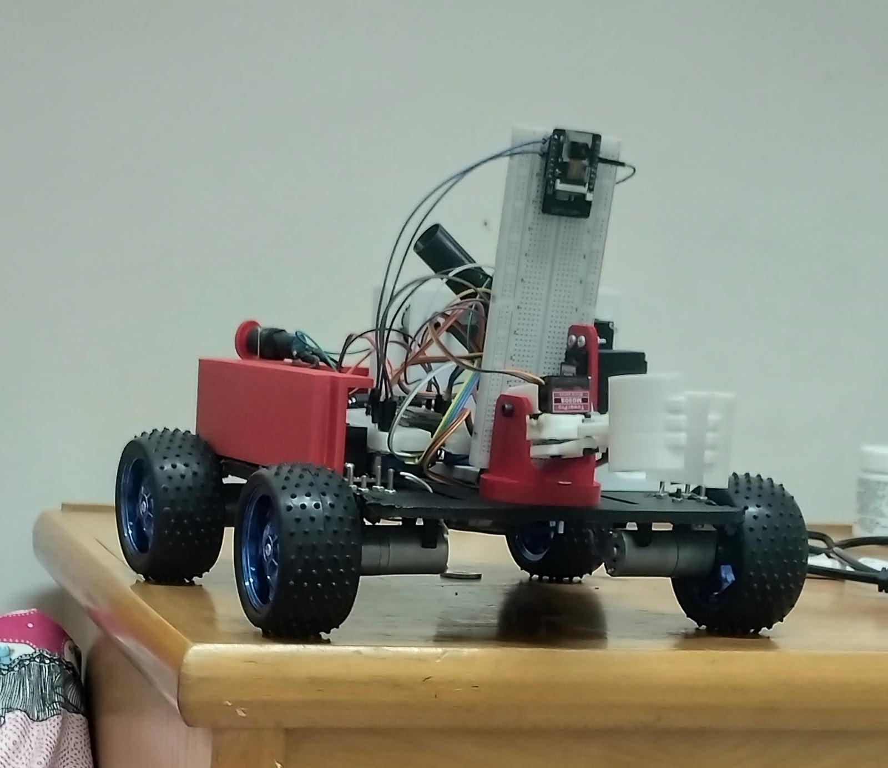
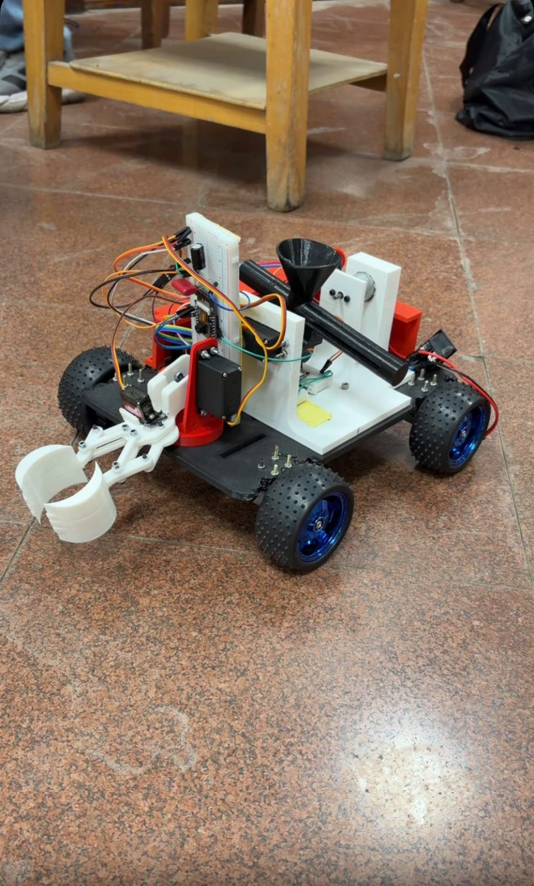

# Robolympics RC Car

An ESP32-powered RC car with AI object detection and a robotic arm, built for the Robolympics competition.

## Features
- Remote-controlled driving using ESP32
- AI object detection
- Robotic arm controlled by the system
- Shooting mechanism

## Competition
- Aviation Club Robolympics
- 6th place out of 12 teams

## Hardware
| Part | Details |
|------|---------|
| Microcontroller | ESP32 |
| Motor driver | [L298N] |
| Motors | [4x JGA25-370] |
| Camera | [ESP32 Cam] |
| Power | [2x 3.7Vx3 lithium ion battery] |

## How it works
The camera captures images, the AI model detects objects, and commands are sent to the ESP32, which drives the motors and moves the robotic arm.

## Photos

## License
MIT
